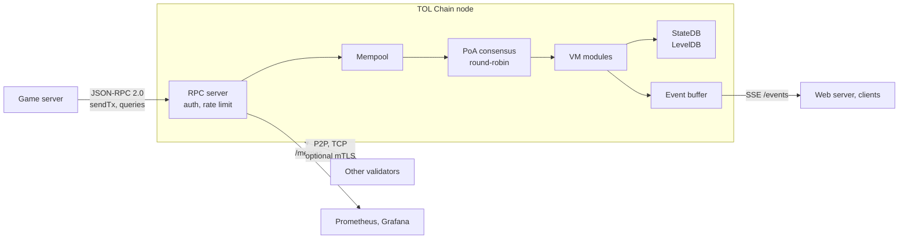

# TOL Chain

> Game-specialized private blockchain written in Go

[](https://github.com/tolelom/tolchain/actions/workflows/ci.yml)


Go · Proof-of-Authority · LevelDB · JSON-RPC 2.0 · SSE · Prometheus

## Overview

TOL Chain is a Proof-of-Authority blockchain for MMORPG backends. Game servers sign and submit transactions for item drops, trades, and session results, and the chain keeps a tamper-proof, auditable record of tokens and assets.

The validators are the game operator's own nodes, so a public consensus protocol (mining or staking) adds cost without adding trust. Known validators produce blocks in round-robin order (2-second interval by default), which keeps block production and validation simple.

The A301 MMO game server uses TOL Chain through a JSON-RPC client for player wallets and boss raid reward payouts.

## Architecture



Transactions run in pluggable VM modules (asset, delegation, economy, inventory, market, random, reward, session). Events raised during block execution are buffered and published only after the block commits.

## Features

- Asset management: mint, burn, and transfer with schema-validated templates
- In-game marketplace: list, buy, and cancel; equipped items cannot be listed
- Game sessions: stake locking, multi-player consent signatures, reward distribution
- Inventory: slot-based equipment; equipped items cannot be traded or burned
- Batch rewards: atomic token and asset grants (operator only)
- Delegation: an owner grants or revokes operator permission for another key
- Commit-reveal randomness for fair drops
- SSE event stream with type filtering
- Per-transaction and per-block state rollback on failure
- Bearer token auth and per-IP rate limiting on RPC, optional mTLS for P2P
- Prometheus metrics for consensus, mempool, network, and RPC

## Project Structure

```
tolchain/
├── cmd/node/           # Entry point, CLI flags, graceful shutdown
├── config/             # Config loading, validation, genesis block
├── consensus/          # PoA round-robin block production & validation
├── core/               # Block, Transaction, Account, Asset, Mempool
├── crypto/             # SHA-256, ed25519, TLS cert generation
├── events/             # Pub/Sub emitter with commit-deferred buffering
├── indexer/            # Secondary indexes (owner→assets, player→sessions)
├── internal/testutil/  # In-memory DB & block store for tests
├── metrics/            # Prometheus metric definitions
├── monitoring/         # Prometheus/Grafana configuration
├── network/            # TCP P2P, peer management, block sync
├── rpc/                # JSON-RPC 2.0 server, rate limiter, SSE broker
├── scripts/            # Deployment automation
├── storage/            # LevelDB wrapper, StateDB with snapshot/rollback
├── tests/              # Integration tests & benchmarks
├── vm/                 # Transaction executor & handler registry
│   └── modules/        # asset, delegation, economy, inventory, market, random, reward, session
└── wallet/             # Key generation, AES-GCM keystore, tx builders
```

## Getting Started

### Dev Mode (no config file needed)

```bash
# Generate a validator key
export TOL_PASSWORD=my-secret
go run ./cmd/node --genkey

# Start the node (auto-creates genesis with the loaded key)
go run ./cmd/node
```

The node starts on `:8545` (RPC) and `:30303` (P2P).

```bash
# Test RPC
curl -s -X POST http://localhost:8545 \
  -H 'Content-Type: application/json' \
  -d '{"jsonrpc":"2.0","method":"getBlockHeight","params":{},"id":1}'

# Check node status
curl -s http://localhost:8545/status | jq
```

### Docker

```bash
# Automated single-node setup
./scripts/setup.sh

# Start all services (node + Prometheus + Grafana)
docker compose up -d

# Logs
docker compose logs -f tolchain

# Stop
docker compose down
```

### Build from Source

```bash
make build              # current OS/arch
make darwin-arm64       # macOS Apple Silicon
make linux-amd64        # Linux x86_64
make test               # run tests
make vet                # static analysis
```

CI runs vet, tests with a coverage gate, and on `main` builds and pushes the GHCR image.

## Documentation

| Document | Contents |
|---|---|
| [docs/reference.md](docs/reference.md) | Configuration, RPC API, transaction types, events, metrics, security, game integration examples |
| [CONTRIBUTING.md](CONTRIBUTING.md) | Development setup, testing, adding a new transaction type |
| [CODE_STRUCTURE.md](CODE_STRUCTURE.md) | Code structure walkthrough (Korean) |

## License

MIT. See [LICENSE](LICENSE).
