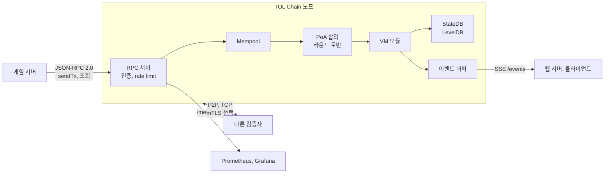

# TOL Chain

> Go로 만든 게임 특화 프라이빗 블록체인

Go 1.26 · Proof-of-Authority · LevelDB · JSON-RPC 2.0 · SSE · Prometheus



MMORPG 백엔드용 Proof-of-Authority 블록체인입니다. 게임 서버가 아이템 드롭, 거래, 세션 결과를 트랜잭션으로 서명해 보내면 체인이 토큰과 자산 기록을 위변조할 수 없게 남깁니다.

## 기능

- 운영자의 검증자 노드가 돌아가며 블록을 만드는 PoA 합의
- 자산 발행, 소각, 전송. 스키마로 검증하는 템플릿
- 게임 내 거래소: 등록, 구매, 취소. 장착한 아이템은 등록 불가
- 게임 세션: 스테이크 잠금, 여러 플레이어의 동의 서명, 보상 분배
- 슬롯 기반 인벤토리. 장착한 아이템은 거래·소각 불가
- 토큰과 자산을 한 번에 지급하는 일괄 보상(운영자 전용)
- 소유자가 다른 키에 운영 권한을 주고 거두는 위임
- 공정한 드롭을 위한 commit-reveal 난수
- 타입으로 거르는 SSE 이벤트 스트림. 블록이 커밋된 뒤에만 이벤트 발행
- 트랜잭션·블록 단위로 실패 시 상태 되돌림
- RPC의 Bearer 토큰 인증과 IP별 rate limit, P2P의 mTLS 선택
- 합의, mempool, 네트워크, RPC의 Prometheus 메트릭

## 시작하기

Go 1.26이 필요합니다. 설정 파일 없이 개발 모드로 띄웁니다.

```bash
git clone https://github.com/tolelom/tolchain.git
cd tolchain
export TOL_PASSWORD=my-secret
go run ./cmd/node --genkey   # 검증자 키(validator.key) 생성
go run ./cmd/node            # 불러온 키를 유일한 검증자로 두고 제네시스 생성
```

```bash
curl -s -X POST http://localhost:8545 \
  -H 'Content-Type: application/json' \
  -d '{"jsonrpc":"2.0","method":"getBlockHeight","params":{},"id":1}'
```

Docker로 노드, Prometheus, Grafana를 함께 띄울 때는 `./scripts/setup.sh`로 `.env`, 키, `config.json`을 만든 뒤 `docker compose up -d`를 실행합니다.

| 접속 | 주소 |
|---|---|
| JSON-RPC | http://localhost:8545 |
| 노드 상태 | http://localhost:8545/status |
| P2P | `localhost:30303` (TCP) |
| Prometheus(Docker) | http://localhost:9090 |
| Grafana(Docker) | http://localhost:3000 |

설정은 `config.json`에서 읽고, 파일이 없으면 개발 모드 기본값을 씁니다.

## 문서

| 문서 | 내용 |
|---|---|
| [ARCHITECTURE.md](ARCHITECTURE.md) | 패키지 구성, 설계 패턴, 트랜잭션 처리 흐름 |
| [docs/reference.md](docs/reference.md) | 설정, RPC API, 트랜잭션 종류, 이벤트, 메트릭, 보안, 게임 연동 예시 |

## 기여

개발 환경, 테스트, 새 트랜잭션 종류를 추가하는 절차는 [CONTRIBUTING.md](CONTRIBUTING.md)에 있습니다.

## 라이선스

MIT. [LICENSE](LICENSE)를 봅니다.
